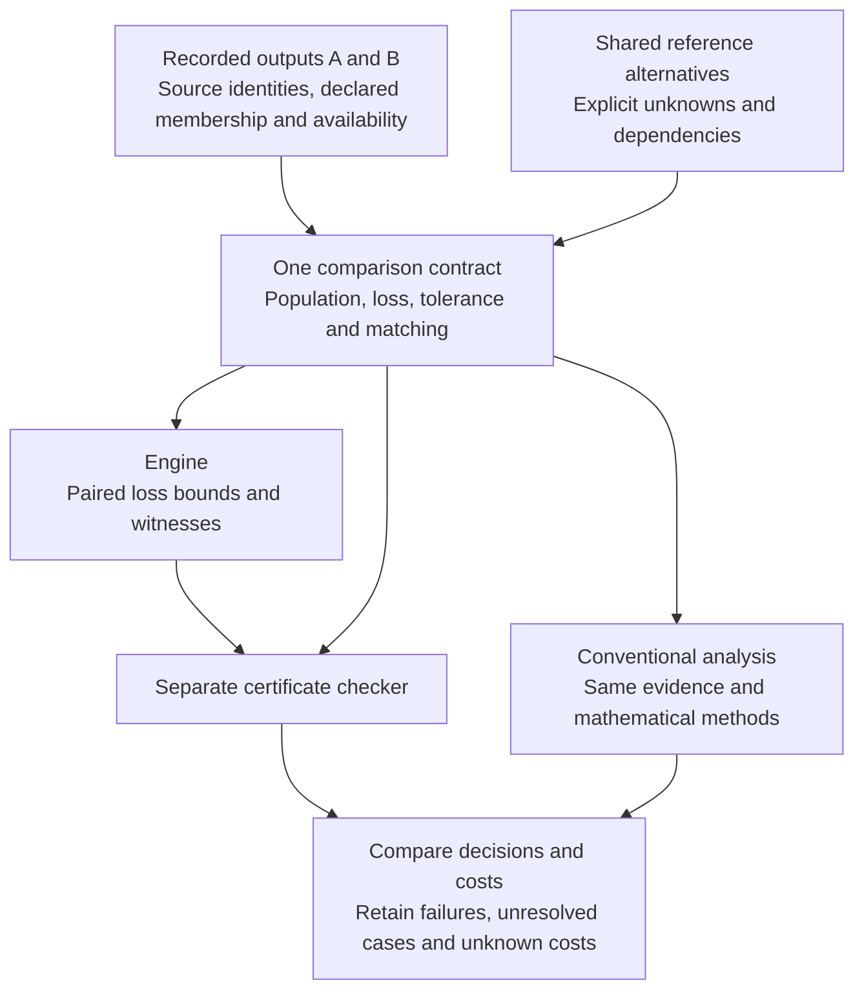
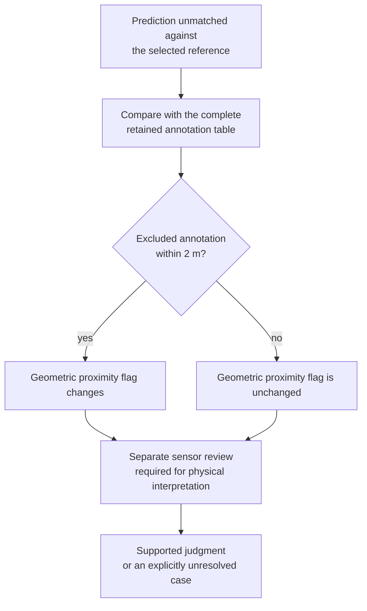
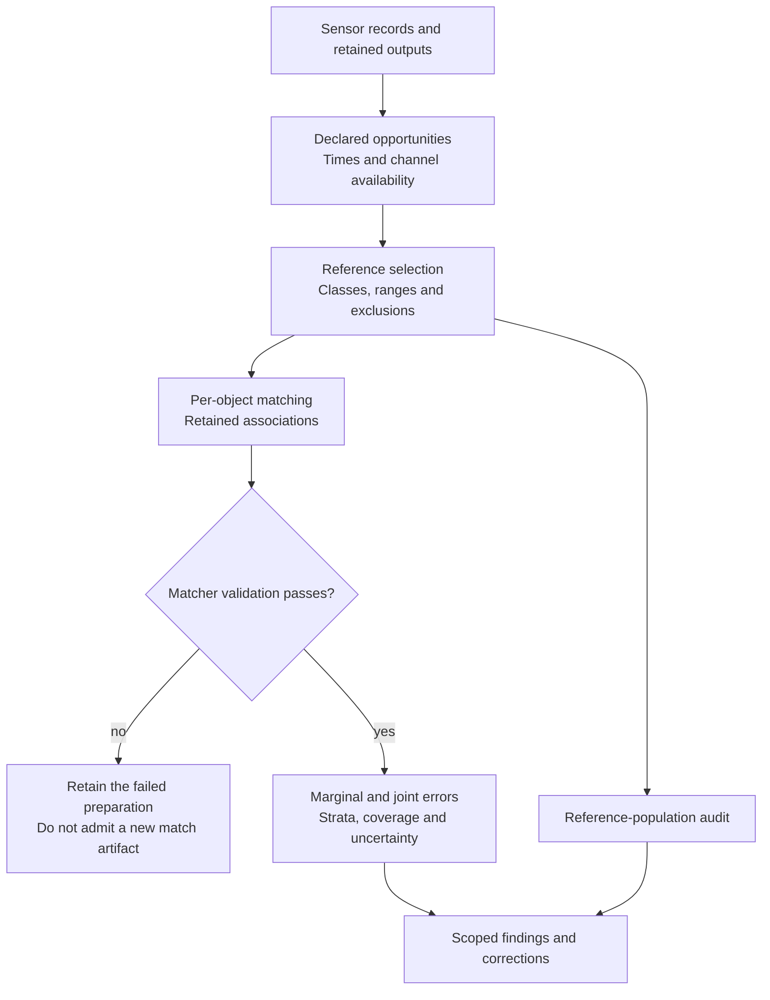
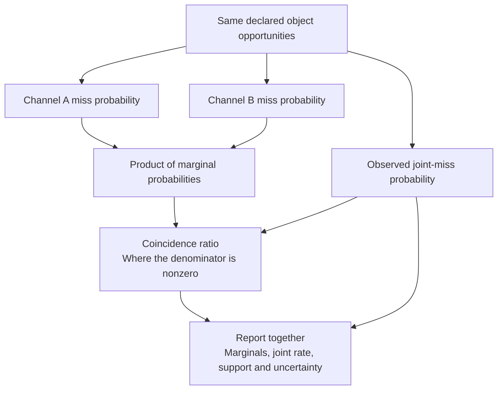
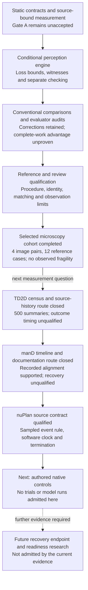
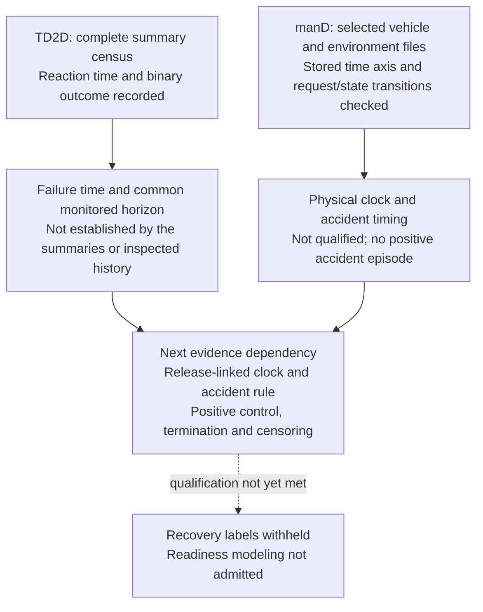
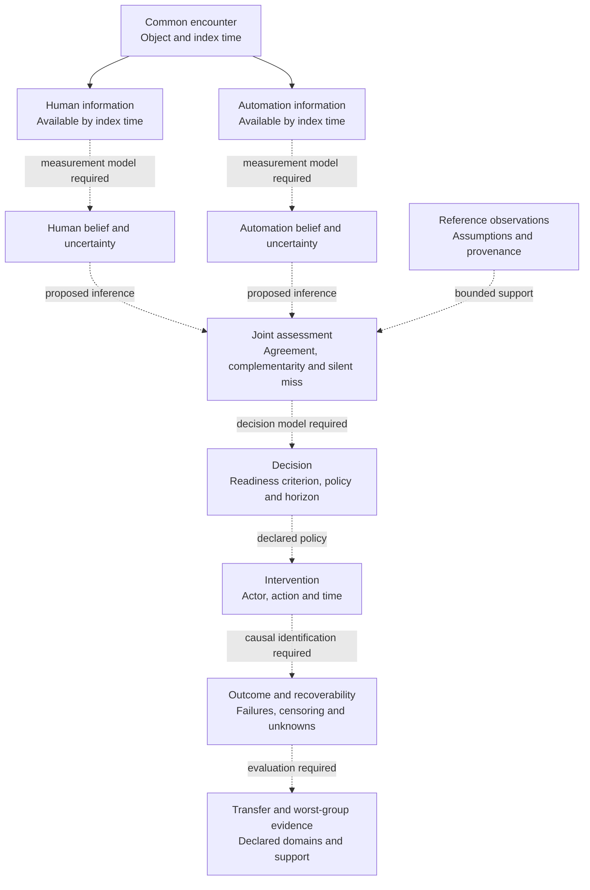
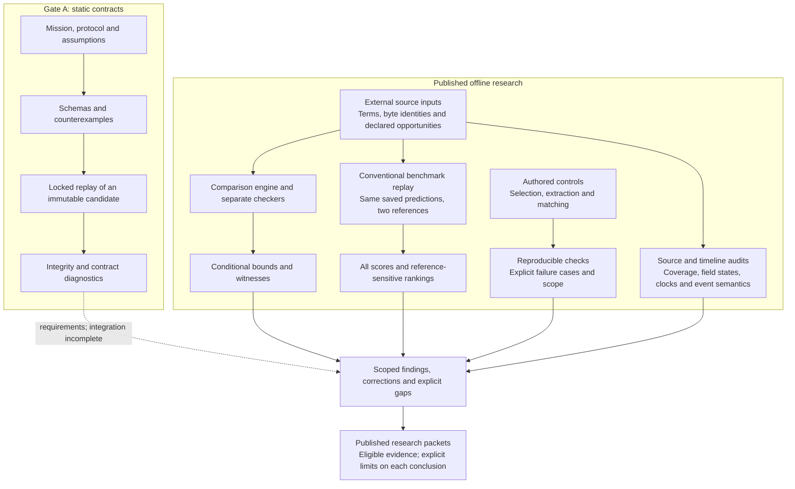
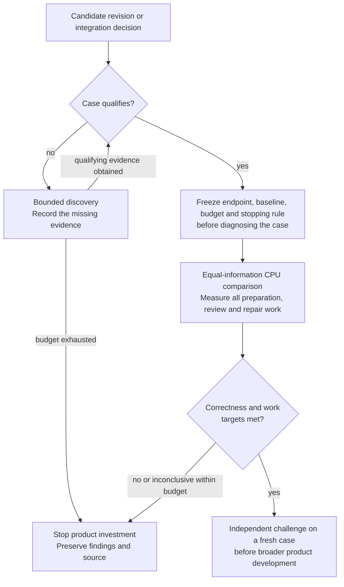

# Reiyah

**Decisions under imperfect evidence.**

Reiyah studies how to justify a change to an autonomous system when the evidence
is incomplete or disputed. Its implemented engine compares perception
configurations against shared reference alternatives and returns checked loss
bounds. It distinguishes an improvement supported by the declared evidence from
one that is excluded or remains unresolved.

The intended user is a perception-validation lead deciding whether a detector
replacement or addition merits further integration work. The research objective
is to reach the same justified decision with less total work, including the cost
of obtaining, reviewing and checking the evidence. **An advantage over competent
conventional analysis remains unproven.**

**Current decision: pause broad engine expansion.** Preserve the conditional
research core and negative results. The [current research release](research/releases/2026-10-11/README.md)
contains the claim corrections, reproducible reference-revision results and the
evidence required before product investment resumes. Subsequent studies complete
a selected perception comparison and audit takeover source coverage and recorded
timelines. The next scientific dependency is a qualified outcome measurement,
before recovery labels or readiness modeling.

Perception is the most developed application within **HARBOR: Human-Automation
Readiness, Belief & Operational Risk**, the proposed wider research program.
Takeover research now tests whether released observations can support a future
recovery endpoint. HARBOR asks what people and automated systems know about the same encounter, when
they miss the same object, and what evidence supports readiness or recovery.
The implemented perception engine and those broader research questions have
different evidence requirements.

[Implemented scope](#implemented-scope) · [Decision model](#the-decision-model) · [Reference example](#when-the-reference-changes-the-answer) ·
[Results](#current-evidence) · [Progress](#research-progression) · [Outcome timing](#takeover-coverage-and-outcome-timing) · [Run the auditor](#run-the-offline-auditor) ·
[Research program](#one-encounter-distinct-information-sets) · [Next decision](#next-research-decision) ·
[Technical map](#research-map) · [Session handoff](docs/SESSION_HANDOFF.md)

## Implemented scope

The wider ambition is a system that helps autonomy teams make consequential
changes on defensible evidence: what improved, where uncertainty remains, and
what observation could change the decision. Each capability must earn its
place through a fair comparison and a useful decision.

| Component | Available today | Evidence boundary |
| --- | --- | --- |
| [Perception comparison](research/perception-revision/0.1.0/README.md) | Conditional loss bounds, witnesses, audit certificates and separate checking for declared reference alternatives. | Correctness depends on the input contract; complete-work savings remain unproven. |
| [Measurement and reference analysis](docs/RESULT_AO_REFERENCE_POPULATION_AUDIT.md) | Offline population, matching and joint-error analyses; [replay of saved predictions under two references](research/reference-revision/0.1.0/README.md). | Recorded annotations and scoring conventions do not establish physical truth. |
| [Input accounting](research/extraction-accounting/0.1.0/README.md) | A helper checks expected membership, decoder failures and source/output identities. | Historical consumers have not integrated it; past cohorts and capture synchronization remain unqualified. |
| [Relational motion](research/continuous-envelope/0.1.0/README.md) | Conditional clearance ranges and opposing witnesses under supplied motion, geometry and timing assumptions. | Authored and bounded recorded-data studies; no deployed monitor or physical safety guarantee. |
| [Takeover source and time audits](research/mand-timing/0.1.0/README.md) | Complete 500-summary TD2D census, public simulator-history inventory and one prospectively selected manD vehicle/environment timeline. | Stored-time alignment is checked; physical clock, failure timing, monitoring and censoring remain unqualified. |
| [Human belief, readiness and recovery](docs/SCIENTIFIC_CHARTER.md) | Proposed constructs and protocols; historical gaze and the current takeover observation audits. | No validated belief inference, readiness model or demonstrated recovery benefit; recovery labels are not admitted. |

The engineering contribution is inspectable conditional reasoning. The product
hypothesis is lower complete decision cost. Their evidence is kept separate.

## The decision model

More detections do not necessarily make a better system. An addition can find
an object, introduce a false detection, or change which existing detection gets
matched. A disputed object near the original detector's output can change the
value of the addition even after every object near the added output has been
confirmed.

Reiyah compares both configurations in the same reference world. Each world
specifies one admissible interpretation of the objects and their matching
relationships. Shared uncertainties remain shared across configurations and
scenes where the declared model requires it. Independently choosing favorable
references for the two detectors would answer a different question.

Misses and false positives carry declared nonnegative penalties; both
configurations use the same population weights. For a fixed loss and improvement
threshold `tau`, write:

```text
delta(w) = loss_A(w) - loss_B(w)
lower <= delta(w) <= upper  for every admitted reference world w
```

A checked lower bound above `tau` supports strict improvement. A checked upper
bound at or below `tau` excludes it. Otherwise the comparison remains unresolved.
A loose enclosure alone does not prove that opposing decisions are possible;
that stronger conclusion requires admissible witnesses on both sides. Failed or
unavailable preparations remain recorded separately.



The implementation uses exact arithmetic, maximum-cardinality one-to-one
matching and separately checked certificates for the supported bound families. It retains
original records, indices and clocks, with traces from a dependency or adverse
interpretation back to its source. These checks establish a conclusion from
specified operands; the quality of those operands remains a measurement question.
These FP/FN loss bounds are not COCO AP bounds. Greedy confidence-ordered AP
has different matching semantics, as the [matching control](research/matching-bound-control/0.1.0/README.md)
demonstrates.

The [replacement interface](research/perception-revision/0.1.0/README.md)
accepts independently declared A/B outputs, checks conditional reference-audit
sufficiency and verifies whether a certificate remains applicable after a
revision. Reuse requires checking the earlier premises. The
[worked examples](research/perception-decision-review/0.1.0/README.md) explain
matching competition, cancellation of shared uncertainty and dependencies that
must survive aggregation.

## When the reference changes the answer

A prediction can be unmatched because the evaluator excluded a nearby
annotation. Absence from that filtered reference differs from absence in the
complete annotation table. Neither, by itself, establishes absence from the
physical scene.

The [reference-population audit](docs/RESULT_AO_REFERENCE_POPULATION_AUDIT.md)
makes this distinction concrete. At a score threshold of 0.30, **3,151 camera
flags and 5,728 lidar flags** were within two metres of annotations excluded
from the original reference: **12.90% and 24.03%** of the respective unmatched
flags under that historical, any-class distance predicate. The annotation could concern a different
class or object. This result changes the geometric flag; it does not adjudicate
the detection as physically correct.



The [real-data replay](docs/REFERENCE_AUDIT_REAL_DATA_2026-09-07.md) and
[cache-policy reconstruction](docs/CACHE_SELECTION_AUDIT_2026-09-07.md)
check the calculation and selection policy separately. The prepared
[adjudication study](docs/REFERENCE_ADJUDICATION_STUDY_2026-09-07.md)
contains 240 detections across 93 scenes; independent human judgments remain
unavailable. Preparing an inspection package does not supply those observations.

The distinction also affects the engine's decision. On the retained two-anchor
case, open physical references produce **[-8, 8]**, while supplied benchmark
labels produce **[1, 1]**. The latter is a conclusion conditional on the labels.
It is not a resolution of the former physical uncertainty.

## Measurement before comparison

A comparison needs a defined opportunity population before it can count a miss.
The sensor record, object class, index time, reference selection and matching
policy determine what was eligible to be observed. Changing that population can
change both the numerator and denominator of a reported rate.



This diagram describes the measurement sequence. The new
[extraction-accounting helper](research/extraction-accounting/0.1.0/README.md)
checks input consumption, but has not been integrated into all historical
consumers. The later [microscopy work](research/multiorg-reference-admission/0.8.0/README.md)
qualifies its own input, output, resource and matching consumers. Neither result
retroactively validates other historical inputs or clocks. This diagram describes
perception measurement; takeover timing has its own qualification below.

An observed empty output, a missing output, an invalid sensor record, an
excluded reference and an unobserved physical object have different meanings.
Unavailable evidence does not become an observed zero. A review must establish
which object, time, class and geometry it actually resolves, and record the
uncertainty that remains.

This is why selecting observations efficiently is only part of the problem.
If two allowed worlds yield the same complete observation transcript but imply
opposing decisions, changing the order of those observations cannot distinguish
them. A different measurement or a justified narrower uncertainty model is
needed. The [observation-contract study](research/observation-contract/0.1.0/README.md)
tests this boundary on the retained timing cases.

## What the joint-error statistic measures

The earlier measurement research asks whether two channels miss the same
reference objects more often than their marginal miss rates would suggest.
For a nonzero marginal product, its coincidence ratio is:

```text
P(A misses and B misses) / [P(A misses) * P(B misses)]
```

The quantities must use the same declared opportunities. Conditional analyses
make the comparison within named strata and retain the support used for
aggregation. The ratio must be read with the absolute joint loss and marginal
rates; it is undefined when the marginal product is zero.



On the audited camera/lidar population, the conditional ratio is **1.151053**,
with a scene-bootstrap percentile interval of **[1.128749, 1.166206]** under
the recorded sampling procedure. This is a descriptive association on a
particular reference population. The interval does not account for every input
error or establish physical error independence, causality or a vehicle safety
rate. The [audit](docs/RESULT_AO_REFERENCE_POPULATION_AUDIT.md) gives the
population, resampling unit, donor rules and sensitivity results.

The [later comparison](docs/FABLE_RAW_CONSUMER_REVIEW_2026-09-13.md)
retains agreement on 270 selected aggregate comparisons. At exactly matched
marginals, the ordering is algebraically the same as intersection and Jaccard
ordering. Claims that wider coefficient margins established stronger evidence
were withdrawn. The [sign correction](docs/FABLE_SIGN_CONSUMER_REVIEW_2026-09-13.md)
also withdraws automatic identification from adding a third detector.
Those corrections remain part of the research record.

## Current evidence

These results summarize retained work through **16 October 2026**. The linked
records contain their complete assumptions, outcomes, failed attempts and costs.
The rows below concern different, sometimes overlapping development studies;
their counts must not be added as independent trials.

### Research progression

The work has moved from conditional mathematics and reference audits to testing
what the observations can actually settle. The diagram follows that research
sequence; an arrow does not transfer validity from one dataset or task to another.



| Research phase | What is retained | What it changes or leaves open |
| --- | --- | --- |
| Architecture and object-level measurement | Separate observation, belief, action, outcome and evidence; reference-population and joint-miss audits. | Explicit opportunity populations and unknowns; Gate A acceptance and physical interpretation remain separate. |
| Conditional decision engine and motion | Exact loss/clearance bounds, opposing witnesses and separately checked certificates. | Conclusions follow declared assumptions; conventional methods reach parity in the retained decision studies. |
| Claim and evaluator corrections | Gaze-selection/sign corrections; greedy-AP matching, successful-empty output and aggregation controls. | Incorrect inferences are withdrawn; source-level controls do not establish published empirical impact. |
| Observation and frontier-method qualification | Recorded reviewer/procedure sensitivity, finite identifiability and exact-choice baselines; motion-consistency and rater-score audits. | Agreement, consistency, physical correctness and acquisition cost are distinct obligations. The [method review](docs/research-decisions/frontier-2026-10-12.md) is dated, not a superiority claim. |
| Microscopy reference comparison | Four selected pairs and twelve fixed reference cases complete; earlier padding, storage and capacity failures retained. | The frozen reference-composition contrast finds no observed fragility. The cohort is closed; full-work savings remain unestablished. |
| Takeover coverage and temporal qualification | Complete TD2D summary census and inspected history; manD metadata coverage and one checked recorded timeline. | Coverage and arithmetic now have explicit scope. Recovery labels still lack qualified clocks, accident semantics and monitored follow-up. |

The following recent endpoints extend the earlier evidence table; they do not
replace its negative results or the detailed dated record below.

### Completed microscopy comparison

The [MultiOrg 0.8.0 packet](research/multiorg-reference-admission/0.8.0/README.md)
completes **four selected image pairs and twelve reference cases**. Two earlier
pairs were checked and reused; two incomplete images completed **624 new forwards**.
All previous invalid exports, interrupted attempts and resource costs remain in
the linked history. This closes the comparison previously reported as incomplete.

Under equal image weights and equal FP/FN penalties, the mean loss difference
`Faster − YOLO` is **G = [126, 201]** when one recorded reference procedure is
shared across images and **P = [119.5, 201]** when procedures may vary by image.
Both intervals favor the exact YOLO variant under that loss. The primary result
is **`no_observed_fragility`**; native, conventional and separate calculations
agree. This is not better recall, physical truth, general superiority or measured
complete-work savings. The exposed cohort is closed to reruns, tuning and expansion.

### Takeover coverage and outcome timing

The [TD2D v2 census](research/takeover-outcome/0.2.0/README.md) now contains
**all 500 original summaries**. Its five required fields admit all 500; the
original full-header contract retains one workload-suffix anomaly and admits 499.
Both contracts produce **242 within-driver/event success–failure pairs**:
**19 faster failures across 11 drivers**, **223 faster successes**, no ties.
All ten published task success counts and reaction-time means reproduce exactly
under the field projection. Reaction time and recorded outcome cannot be
interchanged; these comparisons establish neither a causal effect nor population
risk, physical recovery or road transfer.

Event-to-end differences range from **2,717 to 23,404 ms**; first-action-to-end
from **1,735 to 22,015 ms**. Positive differences do not identify failure-event
time, continuous monitoring, a shared recovery horizon or censoring. The
[history audit](research/takeover-source-lineage/0.1.0/README.md) checks both
advertised simulator branches, **47 commits** and **160 historical Python blob
variants**; it finds no additional Python variants beyond current main. The
required examples-controller path does not appear. That inspected route is closed. It does not
establish the original capture runtime or show that the released labels are wrong.

The next source, [manD 1.0 / Dataverse 2.0](research/mand-timing/0.1.0/README.md),
marks both required channels available in **235 of 300 metadata slots**, including
50 familiarization slots. Availability is not verified trial completeness.
P1's first eligible driven scenario, anger, was selected before opening records;
the condition name is not an inferred emotion. Only its vehicle/environment
state files were extracted for analysis.

Each file has **134,373 rows**, with identical time tokens and exact **1/256**
spacing from **0 to 524.890625 source-time units**. Native acquisition is documented
at **20 Hz**, delivery at **256 Hz**. This supports stored-axis alignment, without
qualifying physical units, origin, native latency or error bounds. Upsampling
does not establish finer native precision.

| manD recorded observation | First episode | Second episode |
| --- | ---: | ---: |
| Takeover request onset, source coordinate | 253.375 | 465.5234375 |
| First following non-request record | 254.42578125 | 467.5234375 |
| First subsequent manual-mode record | 254.4765625 | 468.625 |
| Request-to-manual difference, source units | 1.1015625 | 3.1015625 |

These are message/state differences, not first-action latency or recovery time.
The end-of-ride message begins at **495.57421875**, with another **29.31640625**
source units recorded afterward. Its last segment has no observed next boundary.
The first **33 sensor/automation rows are missing**, not manual mode or zero.
Neither environment accident code 6 nor vehicle accident-message code 13 appears;
absence is not a successful-recovery label or a check of accident detection.



Separate calculations check all TD2D source mappings and 193 strata, and all
268,746 selected manD source rows, 53 categorical runs and 600 coverage cells.
The packets retain 39 TD2D controls and 25 manD controls. These are bounded
calculation checks within this investigation, not independent scientific
replication or outcome validation.

The [source-semantics follow-up](research/mand-semantics/0.1.0/README.md) now closes
the inspected manD documentation route. The described ten-second request budget
is not a qualified recovery horizon. The designated released script has six
processing/extraction functions and supplies no event monitor. No named positive
ego-accident control was identified in the inspected documents. New source-level
evidence is required before another trial can address that gap.

The [nuPlan source audit](research/nuplan-outcome-source/0.1.0/README.md) supplies
an explicit, narrower candidate for sampled simulator outcomes. Its pinned v1.2
code defines first-contact rules, microsecond software timestamps and normal/error
termination paths. Run success and no-at-fault collision are separate observations;
the history endpoint must be checked rather than inferred from a requested duration.
Native behavior and trial coverage remain unverified. No trial data was acquired,
and no upstream simulator code was executed; eleven source-custody controls pass. Motional's code
attribution and Apache-2.0 terms are retained in the packet.

TD2D-derived results credit Jiwoo Hwang, Woohyeok Choi, Jungmin Lee, Woojoo Kim,
Jungwook Rhim and Auk Kim; manD-derived results credit Khazar Dargahi Nobari and
Torsten Bertram. Both sources use CC BY 4.0. The linked packets retain versioned
sources, terms, adaptations and custody. Raw participant streams remain outside
public Git. Retained acquisition and failed-attempt costs remain part of the
record; an unmeasured cost is not zero.

### Earlier evidence and retained limits

The [September 20 research expansion](research/frontier-expansion/0.1.0/README.md)
adds an offline authored clearance contract for ego and lead-vehicle motion.
All 20 cases agree with a separate conventional calculation, retaining six
unresolved, three blocked and one inconsistent-premise case. This establishes
a small checking capability; it is not a driving-performance or safety result.
The [roadmap](docs/ENGINE_ROADMAP_2026-09-20.md) preserves the wider perception,
relational-motion and recovery vision as historical research direction. Its
current decision stops broad expansion pending evidence of workflow value.

The [continuous uncertainty extension](research/continuous-envelope/0.1.0/README.md)
computes tight minimum-clearance ranges with interval observations, a supplied
relative-motion bound and one shared clock offset. Its twenty authored cases
retain five supported, two contradicted, six unresolved, five blocked and two
inconsistent-premise results. Opposing witnesses make the unresolved cases
inspectable; the supplied assumptions still need physical qualification.

| Question | Retained result | Interpretation |
| --- | --- | --- |
| Does a released reference revision change a saved detector ranking? | COCO to COCO-ReM changes the R101-minus-R50 bbox AP gap from **2.327518 to 2.658695 points**; four of 80 category rankings reverse. | Overall ranking unchanged. Conventional evaluation produces the result; no Reiyah benefit was measured. [Replay](research/reference-revision/0.1.0/README.md) |
| Do per-object overlap bounds automatically bound greedy AP? | In a constructed two-prediction case, nominal AP50 is **1** while the upper-overlap endpoint scores **51/101**. | A correctness control, not an empirical gain, new AP engine or demonstrated defect in another paper. [Control and reproduction](research/matching-bound-control/0.1.0/README.md) |
| Does selected gaze coincidence bound population dependence? | Exact completions move the coefficient both above and below the selected value. | The general lower-bound inference and associated safety credit are withdrawn. [Correction](research/claim-correction/0.1.0/README.md) |
| Can reference assumptions change a detector decision? | The two-anchor interval is **[-8, 8]** with open physical references and **[1, 1]** under benchmark labels. | Physical adjudication remains open. [Case](docs/PERCEPTION_ANNOTATION_CASE_2026-09-14.md) |
| Can an audit's sufficiency be checked? | **372 hypothetical confirmed-present labels** attain a checked minimum on one forty-frame case under its deletion model. | This is conditional sufficiency, not measured sequential query cost or reviewer time. [Proof](docs/PERCEPTION_MONOTONE_AUDIT_2026-09-17.md) |
| Which decisions remain unresolved? | All **1,790 unresolved rows** in the 7,707-row operating study have checked opposing worlds; **2,199 rows remain blocked**. | A distinguishing observation or justified change of assumptions is required. [Outcomes](research/operating-timing-witness/0.1.0/OUTCOMES.md) |
| Would complete presence answers resolve timing uncertainty? | All **623 unresolved partial-timing cases** retain opposing decisions with identical complete presence answers and counts. | The construction permits arbitrarily narrow positive-width boxes. It exposes the model's breadth, not the physical shape of cars or ambiguity of every possible transcript. [Study](research/observation-contract/0.1.0/README.md) |
| Has the engine reduced work against strong alternatives? | Conventional methods attain all **99 resolved query floors**; the small certificate-reuse assay is slower than recomputation. | No selection, stopping or complete-cost advantage is established by those studies. [Comparison](research/roadmap-audit/0.1.0/README.md) · [Reuse](docs/PERCEPTION_REVISION_AUDIT_2026-09-16.md) |
| Do adaptive statistical audits help on the retained perception conditions? | None of the tested statistical arms stops earlier than matched exact stopping on the three exposed 64-image conditions. The study retains **11,712 paths** across its authored and perception populations. | Authored errors, unresolved populations and sampled rather than exhaustive checks remain explicit. [Adaptive comparison](research/adaptive-audit/0.1.0/README.md) · [Earlier methods](research/sequential-audit/0.1.0/README.md) |

A conditional proof, a statistical guarantee and a measurement of physical
correctness answer different questions. Checks performed in this development
process are not independent scientific replication. Lower complete validation
cost remains an open hypothesis. All **1,433 outcome-reserved images remain
closed**.

## One encounter, distinct information sets

HARBOR's unit of inquiry is a particular object, encounter and time. A camera
output, a lidar output, a driver's gaze and a takeover action carry different
information. The proposed architecture separates **observation, latent belief,
decision, intervention, outcome and evidence**. Connecting an observation to
belief or readiness requires a validated measurement model.

The diagram describes the research questions and their dependencies. It does
not represent a deployed inference or vehicle-control system.



| Research question | Evidence needed | Present boundary |
| --- | --- | --- |
| Object-level belief | Actor, object, information available at the time, uncertainty and abstention | Static contracts; independent belief measurement remains outstanding. |
| Readiness and recovery | Task requirements, horizon, intervention, recovered state and censoring | Proposed constructs and protocols; no universal readiness score or measured recovery benefit. |
| Joint silent misses | Common opportunities, marginal and joint errors, coverage and strata | Offline detector analyses on declared reference populations. |
| Causal policy effects | Assignment, support, policy versions, outcomes and an identification design | No measured driving-intervention effect. |
| Transfer and worst groups | Declared domains and groups, held-out comparisons, support and missingness | Bounded studies with retained failures; no general transfer guarantee. |

Human-channel studies measure gaze and takeover proxies. Language-model studies
measure error coincidence and monitor transfer on archived answer populations.
Their populations and variables remain distinct from human and vehicle belief
in a shared encounter. The [scientific charter](docs/SCIENTIFIC_CHARTER.md),
[corrected synthesis](docs/GENERAL_SYNTHESIS.md) and
[claim register](evidence/claim-status-register-2026-10-10.json)
set out the scope and corrections.

## Evidence architecture and reproducibility

The repository contains static scientific contracts, offline research tools and
retained experiments. Gate A defines versioned contracts, schemas,
counterexamples and locked validation. The research implementation prepares
comparisons, checks certificates and records scoped findings. Their integration
remains incomplete.



Source hashes bind conclusions to particular bytes. They do not establish that
an annotation is true, a population is complete or a conclusion has been
independently reviewed. Passing a checker is evidence about the implemented
contract. **Gate A remains operator-unaccepted**; the repository does not claim
standards compliance or deployment authority.

### Run the offline auditor

From the repository root:

```sh
python3 -B research/perception-decision-review/0.1.0/reproduce.py
```

This reference calculation uses only the Python standard library. It requires
no sensor dataset, model or API key. Its JSON should match the retained
[expected result](research/perception-decision-review/0.1.0/expected.json).
The examples exercise matching ambiguity, shared uncertainty and reference
dependencies.

The [current research release](research/releases/2026-10-11/README.md) also provides
exact correction controls, a small extraction-accounting check and a four-run
[COCO reference replay](research/reference-revision/0.1.0/README.md). The latter
requires externally obtained, byte-verified score and annotation files; these
payloads are not distributed in the repository. No model inference is required.
The separate [matching control](research/matching-bound-control/0.1.0/README.md)
uses authored boxes and the pinned COCO evaluator, with no external dataset.
It follows the October release and is not part of its immutable tag.

The [engine guide](research/perception-decision/0.1.0/README.md) explains how
to produce and separately verify a comparison packet; it also requires
`jsonschema`. The [replacement guide](research/perception-revision/0.1.0/README.md)
adds independently declared A/B outputs and conditional audit certificates.

For repository research-consistency checks, use an environment with `numpy`,
`scipy` and `jsonschema`:

```sh
python3 -B tools/measure/gate_b_check.py --json /tmp/reiyah-gate-b-check.json
```

The default check verifies retained transcript identities and consistency. It
does not rerun the historical experiments. The
[replay manifest](validation/gate-b-replay-manifest.json) records their input
and environment requirements. Gate A release validation uses its own locked
launcher and immutable candidate procedure.

## Next research decision

**Verify the qualified source contract before acquiring trials.** The nuPlan v1.2
audit supplies explicit sampled event rules, software clocks and normal/error
termination semantics. The next bounded step is an authored native-control check
of positive/negative collisions, track de-duplication, the final history endpoint,
disabled metrics and execution failures. Freeze the cases and budget first; compare
against ordinary direct calculation under equal information. No full simulator
rollout or model campaign is needed for this source-fixture stage.

A later trial protocol must bind a simulator-only endpoint, population, actual
common window and complete run/metric/history receipts. Source inspection does
not establish native behavior, physical clock accuracy, continuous contact,
physical recovery or readiness. The [current decision](research/nuplan-outcome-source/0.1.0/DECISION.md)
and [record obligations](research/nuplan-outcome-source/0.1.0/CONTRACT.md) preserve
those requirements. TD2D, manD and exposed microscopy comparisons remain closed;
no unrelated stream expansion or outreach follows. Gate A remains operator-unaccepted.

### Product-value hurdle remains open

The [current release decision](research/releases/2026-10-11/README.md#next-scientific-investment)
continues the stop on broad evidence-engine expansion. The claim corrections
are now published. An extraction-accounting helper is implemented and checked;
historical cohorts have not been rerun, and consumer integration and physical
synchronization remain open. The [September stopping point](docs/RESEARCH_STOP_POINT_2026-09-21.md)
records why these corrections were required.

Public data and local compute can support further scientific work. Claims about
a real team's saved effort require actual workflow observations and an
accountable decision owner. Proofs and public retrospective studies can proceed
without an external team. The exposed COCO pair is closed without selector
tuning because conventional evaluation already answers its declared ranking
question.

A future product-value test needs a real revision decision: genuine old/new model
artifacts, an owner-defined loss and operating criterion, a qualified review
process and complete measured costs. Reiyah and the strongest applicable
conventional workflow must receive the same evidence and satisfy the same
correctness and resolution obligations. Preparation, reviewer time, retries,
checking, integration and repair all belong in the comparison.

The primary investment hurdle is **at least halved complete active work**, with
equal decision obligations and no observed false assurance. Threefold fewer
expensive observations is secondary. Neither target has been reached; absence
of observed errors would not establish a safety guarantee. Real revision
histories, human review costs and an owner-approved release criterion remain
missing. The [workflow brief](research/value-disproof/0.1.0/WORKFLOW_BRIEF.md) identifies those
inputs; it is not evidence of a customer engagement. No qualifying record is
currently retained. Further authored examples or exposed parity sweeps cannot
substitute for that missing workflow evidence.

Have an existing comparison or scoring result that could help? The
[short submission guide](docs/SHARE_A_COMPARISON.md) explains which records
support each question and links to a public proposal form. Partial records
and explicit unknowns are welcome; no new model run is requested.

Keep discovery to two engineering days within a fourteen-day window when work
is active. An admitted first screen gets at most five engineering days on CPU.
These are resource limits, not an unattended schedule. If no suitable case is
found, or competent conventional evaluation reaches parity, stop this product
investment and preserve the research.

This separate product-investment path remains conditional on an admitted case;
it is not the immediate outcome-qualification task.



The [next-session brief](docs/NEXT_SESSION.md) states the mission, evidence
standard, case-admission fields and first actions. Cloud infrastructure can
support a justified workload; it cannot supply an unresolved decision or
independent reference evidence. A scientifically useful result can be worth
preserving even when it fails the product-value test.

## Recent research

Entries describe the result and next dependency **at that checkpoint**. The
current direction above supersedes historical execution instructions; earlier
failures and incomplete states remain part of the record.

- **16 October 2026:** [nuPlan outcome-source qualification](research/nuplan-outcome-source/0.1.0/README.md). Pinned event rules, software clock and termination paths support a sampled simulator contract; native behavior and trial coverage remain pending. Thirty-three source files and 21 passages are bound; eleven custody controls pass. No trials acquired.
- **16 October 2026:** [manD source semantics and route closure](research/mand-semantics/0.1.0/README.md). The release listing and designated code are checked against retained bytes; the author’s dissertation clarifies the endpoint and design. No release-bound accident monitor or named positive control is identified in this scope. Recovery remains unqualified; nine custody controls pass.
- **15 October 2026:** [manD recorded timelines](research/mand-timing/0.1.0/README.md). Metadata selection precedes inspection; 134,373 vehicle/environment row pairs share an exact stored axis. Two request episodes, missing sensor rows and message/file-end differences remain explicit. Physical clocks, accident timing and monitored recovery are unqualified; 25 controls pass.
- **15 October 2026:** [TD2D source-history closure](research/takeover-source-lineage/0.1.0/README.md). Both advertised branches and 47 commits add no missing Python capture path. The inspected repair route closes; a separately bounded manD documentation screen supplies the next source lead, not a qualified outcome.
- **15 October 2026:** [Complete TD2D census](research/takeover-outcome/0.2.0/README.md). All 500 summaries captured; both admission contracts yield 19 faster failures and 223 faster successes in 242 pairs. All ten source task summaries reproduce. Outcome timing and a common monitored horizon remain unqualified.
- **15 October 2026:** [Initial TD2D audit](research/takeover-outcome/0.1.0/README.md). The partial 161-capture attempt, decimal-parser correction, DNS failure and rate limit are retained. Its five faster failures among 70 pairs are historical; the complete census supersedes that coverage state.
- **15 October 2026:** [Selected microscopy cohort complete](research/multiorg-reference-admission/0.8.0/README.md). Four pairs and twelve reference cases give G=[126, 201], P=[119.5, 201] and `no_observed_fragility`. Two prior pairs reused, 624 new forwards; conventional calculation agrees. Earlier resource failures remain visible, and the exposed cohort is closed without a work-advantage claim.
- **14 October 2026:** [Capacity recovery and the selected cohort](research/multiorg-reference-admission/0.7.0/README.md). Safe cleanup enabled another complete, checked detector pair, bringing coverage to two of four selected images. The next pair stopped at its remaining-capacity boundary; no new reference comparison or cohort endpoint. The resource consumer and matching composition pass 85 public replay controls.
- **14 October 2026:** [Resource admission before another attempt](research/multiorg-reference-admission/0.6.1/README.md). A new supervisor records exact capacity stops and protects receipt publication; 44 authored controls pass. The actual host check refused before worker launch. Storage remains insufficient; the selected detector comparison remains incomplete.
- **14 October 2026:** [Remaining inputs qualified; storage stop retained](research/multiorg-reference-admission/0.6.0/README.md). All three selected images and 936 prospective model inputs are qualified. The next pair stopped at its disk reserve with 70 raw tile ledgers saved; no new complete pair or comparison. The four-image matching adapter is qualified on authored controls. Stable storage headroom is the next execution dependency.
- **14 October 2026:** [First complete image, three checked comparisons](research/multiorg-reference-admission/0.5.0/README.md). Both candidates complete all 156 tiles; 5,460 saved arrays and whole-image outputs pass separate checking. The three fixed reference sets favor YOLO under equal-cost FP + FN, while Faster matches more reference objects. The conventional baseline agrees. The remaining three selected images and any complete-work advantage remain unresolved.
- **13 October 2026:** [Proposal origin preserved through a corrected export](research/multiorg-reference-admission/0.4.0/README.md). The [preceding trace](research/multiorg-reference-admission/0.3.1/README.md) identified a scored zero box as appended RPN padding. On the same exposed tile, a distinct correction excludes that origin before selection and preserves the four selected non-padding detections bitwise. A direct-removal reference agrees on every final output. Complete first-image pair coverage is next; accuracy and work advantage remain unestablished.
- **12 October 2026:** [Repeated expert references, preserved through admission](research/multiorg-reference-admission/0.1.0/README.md). All 165 MultiOrg annotation files were checked across 55 images and 17,208 boxes. The direct source-qualified union exceeds the current object cap on every image; 28 fit when procedures are checked separately. A [diagnostic](research/multiorg-reference-admission/0.2.3/README.md) retained a low-score zero box. A separately qualified [analysis-only contract](research/multiorg-reference-admission/0.3.0/README.md) then passed nine Faster tiles before refusing a zero box above the unchanged analysis threshold. All returned rows are retained; no complete detector pair, ranking or work advantage exists.
- **12 October 2026:** [Selecting responses changes two evidence measures differently](research/response-order-sensitivity/0.1.0/README.md). In 28,626 MVT cells, selecting three lower recorded-time responses increases departure from the full valid-time answer distribution, while unique-modal agreement improves. Exact enumeration checks 1,001,895 subsets. The decision must specify which evidence to preserve; neither result establishes better reviewers, work savings or a Reiyah advantage.
- **12 October 2026:** [Research that changes an engineering decision](docs/research-decisions/research-to-build-2026-10-12.md). A primary-source review informs a small offline intake prototype: exact source passages, explicit method assumptions and unresolved observation requirements. Four exposed development cases exercise reviewability, incompatibility, missing evidence and unchanged closed leads. Research usefulness and complete-work savings remain to be tested.
- **12 October 2026:** [A maximum rater score and its evidence boundary](research/rater-score-contract/0.1.0/README.md). The pinned WOD-E2E helper returns 10/10 with a false same-reference trust flag on an authored case. Another preserves both outputs despite an intermediate excursion. Six cases verify the stated metric’s limits; no empirical ranking impact, safety conclusion or complete-work advantage follows. The real comparison remains unadmitted.
- **12 October 2026:** [Exact choice: sufficient labels and acquired labels](research/exact-choice-baseline/0.1.0/README.md). A separately checked finite AUGRC baseline distinguishes hindsight certificates from queries a procedure must actually acquire. All 12,700 declared candidate configurations agree; the majority control needs two labels in hindsight and three in the optimal worst case. No complete-work advantage is measured.
- **12 October 2026:** [Frontier methods and the next comparison](docs/research-decisions/frontier-2026-10-12.md). Current autonomy documentation and research sharpen the baseline: shared-evidence certificates already have close prior art. A new value experiment still needs a qualified observation process and complete work records. No comparative advantage is claimed.
- **11 October 2026:** [Consistency and reference agreement favor different saved runs](research/motion-consistency-audit/0.1.0/README.md). On a fixed EgoDyn-Bench pair, trajectory-labeled answers improve reference agreement from 49.78% to 63.61% while WPCR falls from 97.87% to 89.66%. All 28,000 answers and both published metric reports verify. Internal consistency and reference agreement are distinct obligations; no causal effect, driving-safety or Reiyah performance advantage is established.
- **11 October 2026:** [Does the review procedure change the decision?](research/review-procedure-sensitivity/0.1.0/README.md) In a recorded 1,000-object Cityscapes sample, 133 objects have incompatible majority outcomes across proposed-class and no-proposal review under every declared one-response-per-ID choice; 17 have different ordinary class majorities. Separate enumeration verifies all pairs. This establishes recorded procedure sensitivity, not physical truth, a causal effect or work savings.
- **11 October 2026:** [Can the available observations justify a decision?](research/resolution-identifiability/0.1.0/README.md) A finite observation check preserves correlated responses and overlapping acceptable decisions. A separate adaptive-tree calculation agrees across 31,213 authored models; 28 malformed-input and forged-result controls reject. Actual review channels and work savings remain unqualified.
- **11 October 2026:** [Mean errors must not depend on processing batches](research/metric-aggregation-control/0.1.0/README.md). An authored mean-TV comparison reverses when only chunk size changes. Collecting every image's metric arrays restores the detection-weighted means across 90 configurations; 1,656 numeric means and 504 undefined fields verify. AUSRC is unchanged by this correction. Published empirical impact remains unknown.
- **11 October 2026:** [Successful empty outputs and scoring populations](research/empty-output-score-control/0.1.0/README.md). A constructed native AUSRC comparison reverses when an omitted reference image is counted: A changes from 1 to 51/101 while B stays at 0.8. The tested correction preserves nonempty-image tensors; an independent rational checker verifies 51 scores and denominators. Published empirical impact remains unknown.
- **11 October 2026:** [Reference policies can reverse a threshold choice](research/threshold-reference-screen/0.1.0/README.md). Two fixed confidence thresholds exchange preference between COCO and COCO-ReM under equal FP/FN loss. All 20,000 per-image count records verify. In a declared policy-disclosure simulation, a conventional order needs 204 disclosures and the hindsight minimum is 148, leaving at most 1.38× count savings. No complete-work advantage is established.
- **11 October 2026:** [Recorded reviewer identities and majority decisions](research/reviewer-identity-sensitivity/0.1.0/README.md). Counting one observed response per recorded ID preserves the raw majority outcome for 996/1,000 proposed-class and 988/1,000 no-proposal object records. No ordinary class majority can switch directly to another ordinary class. This qualifies a reference-policy sensitivity, not voter independence, physical truth or work savings.
- **11 October 2026:** [Overlap bounds and greedy matching](research/matching-bound-control/0.1.0/README.md). An authored finite counterexample checks a tempting AP shortcut. Native and exact calculations agree; novelty, empirical impact and a Reiyah advantage remain unestablished.
- **11 October 2026:** [Verification metadata clarification](research/releases/2026-10-11/verification-note-0.1.0.json). The retained launch status differs from the completed replay result; the original release tag and scientific results are unchanged.
- **11 October 2026:** [Corrected research release](research/releases/2026-10-11/README.md). Claim corrections, extraction source, portable reference-revision replay, complete result disclosure and current investment limits.
- [21 September: exact native-grid fidelity](research/grid-fidelity/0.1.0/README.md) resolves the exposed replay with 69 logical reveals per method; equal-information comparison remains tied.
- [21 September: complete-cohort mapping decision](research/decision-value/0.1.0/README.md) supports three recorded replacements and leaves one blocked; the competent conventional method agrees.
- [21 September: recorded navigation fidelity](research/navigation-measurement/0.2.0/README.md) supports the fixed recorded requirement; the conventional method uses one fewer logical sample.
- [21 September: navigation measurement attempt](research/navigation-measurement/0.1.1/README.md) retains an initialization-only sample, zero eligible cases and the stronger conventional alternative.
- [21 September: complete measurement resolution](research/measurement-resolution/0.1.0/README.md) checks every feasible response, executes acquisition and retains uncertainty and conventional parity.
- [21 September: nominal separation](research/nominal-separation/0.1.0/README.md) retains a 2.7 cm reversal, full conventional parity and unresolved physical uncertainty.
- **21 September 2026:** [Recorded clock-alignment decision](research/clock-alignment/0.1.1/README.md). No constant offset preserves all 2,504 supported target-to-ego associations; 1,933 earlier targets remain unsupported. Both methods reject after three logical reveals, with no query advantage or physical timing guarantee.

- **20 September 2026:** [Recorded coordinate-export decision](research/compact-motion/0.1.1/README.md). All 4,437 selected ViF-GTAD target records differ between CSV and MAT, by up to 6.63 m under the declared spherical comparison. Both methods reject lossless substitution after one logical reveal; no query advantage or physical clearance claim follows.
- **20 September 2026:** [Physical source qualification](research/physical-source/0.1.0/README.md). Pinned 7V-Scanario metadata supplies a concrete geometry/motion lead. No listed archive fits current limits; physical uncertainty remains unresolved. The retained contract specifies the smallest useful extract.
- **20 September 2026:** [Continuous clearance and distinguishing observations](research/continuous-envelope/0.1.0/README.md). Exact conditional ranges agree with a separate conventional calculation. Six authored ambiguities retain opposing trajectories; the failed control and corrected freeze remain available.
- **20 September 2026:** [Public vehicle-pair qualification](research/public-motion/0.1.0/README.md). Eight fixed NGSIM windows support their sampled longitudinal-proxy statements; all eight physical continuous-clearance claims remain unresolved. The separate conventional calculation agrees.
- **20 September 2026:** [Presence/count answers and timing uncertainty](research/observation-contract/0.1.0/README.md). Opposing decisions can share the same complete presence transcript under the retained optional-box model.
- **19 September 2026:** [Adaptive audit comparison](research/adaptive-audit/0.1.0/README.md). Tested betting methods do not improve query counts on the selected perception conditions.
- **19 September 2026:** [Sequential audit methods](research/sequential-audit/0.1.0/README.md). Exact checks on authored populations distinguish method validity from practical value.

The [earlier research narrative](docs/README_RESEARCH_HISTORY_2026-09-19.md)
retains the complete pre-reorganization README, including the historical
research-lane arrangement. The [handoff](docs/SESSION_HANDOFF.md) carries
current continuation instructions. Neither a new date nor a new test count
changes the scope of an earlier result.

## Research map

| Read for | Start here |
| --- | --- |
| Engine model and mathematics | [Architecture](docs/PERCEPTION_DECISION_ARCHITECTURE_2026-09-09.md) · [Replacement interface](research/perception-revision/0.1.0/README.md) |
| Current direction and evidence | [Progress map](#research-progression) · [Next-session brief](docs/NEXT_SESSION.md) · [Research release](research/releases/2026-10-11/README.md) · [Evidence inventory](research/releases/2026-10-11/evidence.json) · [Roadmap](docs/ENGINE_ROADMAP_2026-09-20.md) · [Execution audit](research/roadmap-audit/0.1.0/README.md) · [Primary-method review](research/roadmap-audit/0.1.0/FRONTIER.md) |
| Takeover coverage and outcome timing | [Complete TD2D census](research/takeover-outcome/0.2.0/README.md) · [Source-history closure](research/takeover-source-lineage/0.1.0/README.md) · [manD timeline](research/mand-timing/0.1.0/README.md) · [manD source closure](research/mand-semantics/0.1.0/DECISION.md) · [Current nuPlan source contract](research/nuplan-outcome-source/0.1.0/README.md) |
| Selected reference cohort | [Complete four-image result](research/multiorg-reference-admission/0.8.0/README.md) · [Preserved resource failures](research/multiorg-reference-admission/0.7.0/README.md) |
| Relational motion research | [Clearance contract](research/frontier-expansion/0.1.0/README.md) · [Current primary research](research/frontier-expansion/0.1.0/SOURCES.md) · [Earlier source scope](research/frontier-expansion/0.1.0/qualification.json) · [NGSIM source adapter](research/public-motion/0.1.0/README.md) |
| Physical measurement contract | [Source qualification](research/physical-source/0.1.0/README.md) · [Geometry, motion and coverage](research/physical-source/0.1.0/CONTRACT.md) |
| Recorded input-admission decision | [ViF-GTAD export comparison](research/compact-motion/0.1.1/README.md) · [Frozen question and baseline](research/compact-motion/0.1.1/DECISION_PLAN.md) |
| Wider scientific program | [Charter](docs/SCIENTIFIC_CHARTER.md) · [Mathematical specification](docs/MATHEMATICAL_SPECIFICATION.md) · [Corrected synthesis](docs/GENERAL_SYNTHESIS.md) |
| Reference validity and review | [Population audit](docs/RESULT_AO_REFERENCE_POPULATION_AUDIT.md) · [Adjudication study](docs/REFERENCE_ADJUDICATION_STUDY_2026-09-07.md) · [Threats to validity](docs/MEASUREMENT_THREATS_TO_VALIDITY.md) |
| Corrections and prior results | [Matching control](research/matching-bound-control/0.1.0/README.md) · [Claim register](evidence/claim-status-register-2026-10-10.json) · [Sign correction](docs/FABLE_SIGN_CONSUMER_REVIEW_2026-09-13.md) · [Retained history](docs/README_RESEARCH_HISTORY_2026-09-19.md) |
| Contracts, sources and terms | [Gate A architecture](docs/ARCHITECTURE.md) · [Source policy](docs/SOURCE_POLICY.md) · [Public-data custody](docs/PUBLIC_DATA_CUSTODY_2026-09-06.md) · [Standards crosswalk](docs/STANDARDS_CROSSWALK.md) |
| Product hypothesis and contribution | [Intended users and proof milestones](docs/PRODUCT_AND_FUNDING_THESIS_2026-09-14.md) · [Contributing](CONTRIBUTING.md) · [Security](SECURITY.md) |

## Author, license and citation

Created and maintained by **Daniel Wahnich**.

Reiyah-authored code and documentation are distributed under [Apache-2.0](LICENSE).
Third-party materials retain their own terms; see [NOTICE](NOTICE).
Cite the exact result and commit reviewed. The [research release](research/releases/2026-10-11/README.md)
gives its citation; [CITATION.cff](CITATION.cff) describes the historical Gate A architecture.
