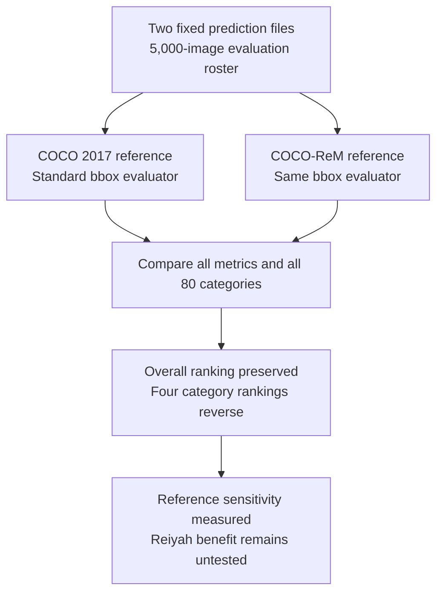

# Fixed predictions under a revised reference

Document ID: `reiyah.reference-revision`. Version: `0.1.0`.
Status: exploratory retrospective sensitivity screen, 11 October 2026.

**The overall ranking did not reverse.** Detectron Mask R-CNN R101-FPN remains
ahead of R50-FPN when the reference changes from COCO 2017 validation to the
released COCO-ReM validation annotations. Four of 80 category rankings reverse.
These are conventional evaluator results. No Reiyah arm or human work saving
was measured.

## Question and result

Hold both saved prediction files, all 5,000 images, all 80 categories and the
COCO bbox evaluator fixed. Change only the released reference. The original
screen plan was frozen before acquiring the revised annotation payload; the
original scores and the paper's general motivation were already known.
This public edition was prepared after seeing the outcomes. It is not a new
preregistration or an unexposed test of a selection method.

| Model or difference | COCO 2017 | COCO-ReM | Change |
| --- | ---: | ---: | ---: |
| R50-FPN bbox AP | 37.683132 | 36.618957 | −1.064176 |
| R101-FPN bbox AP | 40.010650 | 39.277652 | −0.732999 |
| R101 minus R50 | 2.327518 | 2.658695 | +0.331177 |

Values are AP points on a 0–100 scale. Standard COCO bbox AP uses ten IoU
thresholds from 0.50 to 0.95, 101 recall thresholds, all categories and
`maxDets=[1,10,100]`. The original scores reproduce the publisher's rounded
37.7 and 40.0. These historical architectures are not contemporary frontier
baselines. This is not a replication of the COCO-ReM paper's mask or boundary AP.

| Descriptive category | Original R101 minus R50 | Revised R101 minus R50 |
| --- | ---: | ---: |
| frisbee | +0.566501 | −1.305793 |
| banana | +0.090743 | −0.121445 |
| apple | +1.366723 | −0.407132 |
| microwave | −0.629745 | +2.041675 |

[expected.json](expected.json) contains all 80 categories and all twelve standard
metrics for each of the four evaluations. The four sign changes are secondary,
descriptive quantities. They do not replace the unchanged primary ranking or
establish statistical significance. No population confidence interval is claimed
for this fixed-file calculation.

## Reference and execution boundaries

The released references contain 36,781 and 40,713 annotations, respectively.
Image IDs, dimensions, category IDs and names match. The revised file attributes
33,496 records to COCO, 6,135 to LVIS and 1,082 to manual annotation. Its count
differs from the paper's stated 40,689; this release-specific difference remains
visible. Reference changes reflect annotation policies and geometry as well as
possible corrections. They are not a measured error rate or independently
established physical truth. [reference-summary.json](reference-summary.json)
retains the original compatibility and provenance-count analysis.

The prediction files have 161,111 and 152,180 rows. Seven and eight roster images
have no submitted rows. Original inference completion is unverified. The replay
uses the publisher's score-file convention: an absent row supplies no detection
to the evaluator. It does not certify a successful empty inference. Strict
admission as a complete inference record remains blocked; conditional benchmark
scoring is the explicitly narrower calculation performed here.



## Reproduce on CPU

Use Python 3.10 or newer; the recorded local run uses Python 3.13.5. Create an
environment with [requirements.txt](requirements.txt). The harness checks exact
versions and the evaluator's Python source digests. Native binary identities and
platform are recorded in each output; another platform has not yet been tested.

```sh
python3 -m venv /tmp/reiyah-reference-env
/tmp/reiyah-reference-env/bin/python -m pip install \
  -r research/reference-revision/0.1.0/requirements.txt
```

Obtain the four files in [inputs.json](inputs.json) from their listed publishers,
under their applicable terms, in a directory outside this repository:

- `r50.json` and `r101.json`: download the respective saved Detectron results and
  use these local names. No weights or detector execution are required.
- `instances_val2017.json`: extract this member from the official COCO annotation
  archive's `annotations/` directory.
- `instances_valrem.json`: extract the pinned COCO-ReM validation archive.

The four extracted files total about 98 MB. Downloading the complete original
COCO archive additionally requires about 253 MB of transfer. Existing authorized
copies with matching hashes can be reused. No images or training data are needed.
The source and output directories below must be real paths chosen by the caller;
the output directory must not already exist.

```sh
/tmp/reiyah-reference-env/bin/python -B \
  research/reference-revision/0.1.0/reproduce.py \
  --data-dir /absolute/local-inputs \
  --output /absolute/fresh-replay
```

The command first rechecks the complete reference summary with [qualify.py](qualify.py),
then runs four evaluations sequentially in separate processes, preserves
logs, and compares all twelve metrics and all category AP values with the retained
results at absolute tolerance `1e-10` on the fractional scale. Changed or missing
inputs, evaluator source changes, numeric mismatches and worker failures block a
successful result. A failed destination remains available for inspection; use a
fresh destination for another attempt. Keep input files stable during execution.
This harness admits only these pinned files; it is not a general dataset validator.

Allow a few CPU minutes and roughly 2 GB of available memory. The original
individual scoring processes peaked near 1.1 GB on the local Mac. These are
engineering observations, not portable latency guarantees. Execution time excludes
human investigation, data acquisition and historical annotation work. Full review
cost was not measured.

## Provenance and redistribution

[provenance.json](provenance.json) records the original local plan and execution
digests, source metadata, and the distinction between retained private records
and public reproduction. [inputs.json](inputs.json) binds every required input
to exact bytes. This release contains authored code, derived aggregate results
and source metadata. It contains no third-party prediction file, annotation file,
image, model weight, paper body or upstream implementation. The portable harness
is new; its numeric outputs are checked against the original retained runs.

The Detectron model zoo explicitly licenses models, but redistribution permission
for these result files was not established. They are therefore obtained directly
from the publisher, not bundled. The COCO annotations and COCO-ReM dataset card
state CC BY 4.0. Those source terms remain separate from Reiyah's Apache 2.0 license.

Primary references:

- [Detectron model zoo](https://github.com/facebookresearch/Detectron/blob/main/MODEL_ZOO.md):
  the published R50/R101 configurations and saved results; exact payload URLs and
  hashes are in the input manifest.
- [COCO download page](https://cocodataset.org/#download): original validation annotations.
- Singh, Yadav, Jain, Shi, Johnson and Desai, *Benchmarking Object Detectors with
  COCO: A New Path Forward*, [arXiv v1, 27 March 2024](https://arxiv.org/html/2403.18819v1);
  [author implementation at the inspected commit](https://github.com/kdexd/coco-rem/tree/73e38364a787b34cbcd846739f196f066430279b),
  whose README lists ECCV 2024. The [dataset revision](https://huggingface.co/datasets/kdexd/coco-rem/tree/87e991af381412ae4b6fff5f017172d9fd206813)
  identifies the actual annotation release used.

## Research decision

Close this exposed detector pair without tuning a selector on its outcomes.
The result supports studying reference-sensitive decisions. It supplies no
evidence that Reiyah improves on conventional analysis: that analysis already
produced the complete result with all supplied annotations. Reiyah's native
conditional FP/FN loss is also a different target from COCO AP.

A future comparison must name an unresolved decision, use a compatible loss,
provide both methods equal information and guarantees, and measure acquisition,
review, checking and integration work. A public retrospective case can establish
a scoped algorithmic result. Claims about saved team effort require actual
workflow observations. Neither outcome follows from this screen.
