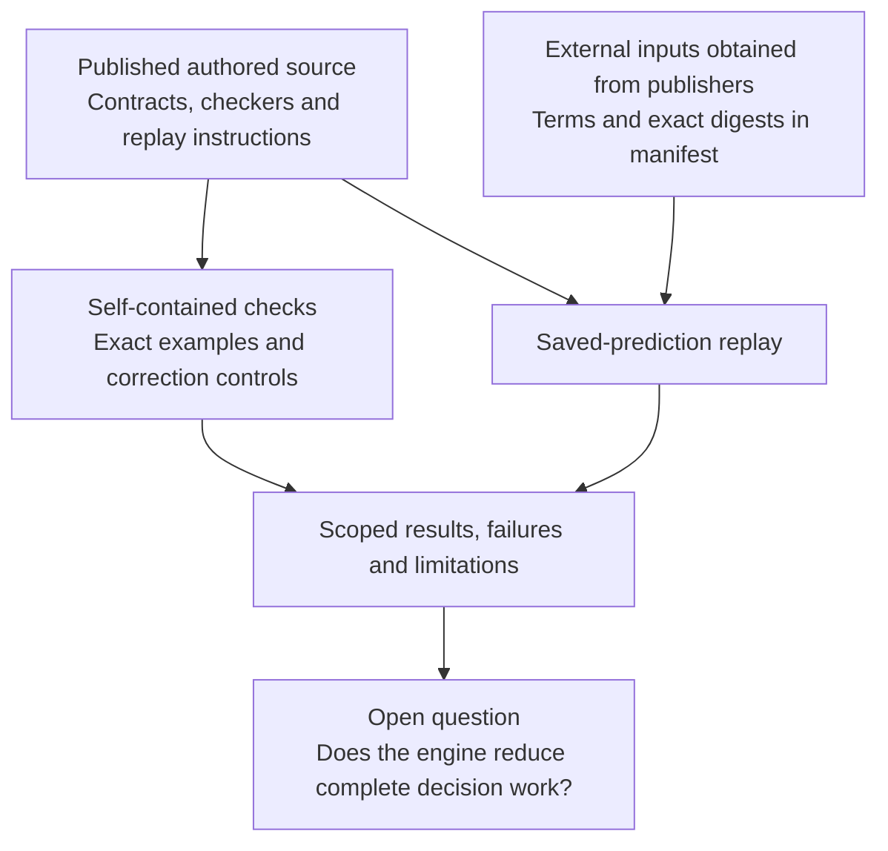

# Reiyah research release: 11 October 2026

Document ID: `reiyah.research-release.2026-10-11`. Version: `0.1.0`.
Status: corrected research publication. This is an offline research release;
production readiness and state-of-the-art performance are not established.

## Decision

Preserve the conditional comparison engine and continue a bounded search for
decision value. Broad product expansion remains paused. The new work corrects
unsupported interpretations, makes extraction failures explicit, and publishes
a reproducible reference-revision screen. It does not establish a new perception
method, lower total review cost, a safety guarantee or commercial differentiation.

Reiyah's research proposition remains useful to test: **can we reach the same
justified perception-revision decision with less complete work?** The current
record does not answer yes. Conventional methods match the exposed development
comparisons; the recent public benchmark replay did not require a Reiyah arm.

## What this release includes

| Component | Implementation or finding | Verification boundary |
| --- | --- | --- |
| [Claim correction](../../claim-correction/0.1.0/README.md) | Exact counterexamples disprove the claimed selected-population bound. Human and LLM interpretations and the successor register are corrected. | Rational arithmetic and retained transcript counts; no new inference or bootstrap replay. |
| [Extraction accounting](../../extraction-accounting/0.1.0/README.md) | Declared camera/gaze membership, process failures and source/output identities; complete consumption is required. | Authored unit controls and actual decoding of tiny generated videos. Historical datasets were not reprocessed; no model consumer integrates the helper yet. |
| [Reference revision](../../reference-revision/0.1.0/README.md) | Both saved Detectron outputs evaluated under COCO and COCO-ReM. Global ranking unchanged; four category sign changes. | All 5,000 images and 80 categories. Standard conventional bbox evaluation; no measured Reiyah benefit. |
| [Existing comparison engine](../../perception-revision/0.1.0/README.md) | Shared reference worlds, conditional loss bounds, certificate production and separate checking. | Existing source retained. Mathematical correctness remains conditional on its model and premises. |

[evidence.json](evidence.json) indexes the release findings and the recent
negative or incomplete screens. [verification.json](verification.json) records
the checks actually performed for this publication. Neither is independent
scientific replication. Source fingerprints identify bytes, not physical truth.

[Verification metadata clarification](verification-note-0.1.0.json): the nested
source-binding status `running` records launch time. The completed result is
`matched_retained_numeric_results`, with all four evaluations recorded. The
original verification bytes and release tag are preserved; no result changed.

## Corrections that matter

Detector-selected gaze measurements do not identify awareness or give a general
lower bound on population dependence. Adding omitted objects can move the
normalized coefficient in either direction. A coefficient near one does not
certify human-machine independence. Language-model coincidence measurements also
do not establish a universal same-kind/cross-kind law or a literal count of
independent models. The associated safety-evidence credit is withdrawn.

The original measurements and transcripts remain available. The
[successor claim register](../../../evidence/claim-status-register-2026-10-10.json)
preserves prior entries and records the corrected interpretations. Historical
leaf documents that retain older prose mark its superseded status explicitly.

The extraction helper addresses an ordinary but consequential reliability gap:
historical scripts ignored decoder return codes and could omit inputs. Whether
this occurred in the retained research runs is unknown. The new helper does not
retroactively validate those runs. Matching frame ordinals does not establish
capture synchronization, gaze validity or complete population selection.

## What the latest empirical screen established

| Bbox AP points | COCO 2017 | COCO-ReM |
| --- | ---: | ---: |
| R50-FPN | 37.683132 | 36.618957 |
| R101-FPN | 40.010650 | 39.277652 |
| R101 advantage | 2.327518 | 2.658695 |

The reference affects scores and some category orderings. It does not change the
overall choice in this pair. The conventional evaluator computes the result from
the complete supplied annotations. Lower scores after a reference change are
not model regressions: the predictions stayed fixed.

This is a released-reference sensitivity measurement, not a new driving truth
set, a contemporary detector benchmark or a demonstration of saved work. The
original per-image inference completion records are unavailable. The replay
explicitly uses the publisher's submitted-score convention for absent rows.

## Reproduction and source boundaries

Start with the standard-library [offline auditor](../../perception-decision-review/0.1.0/README.md)
and the [correction probe](../../claim-correction/0.1.0/README.md). Then use the
versioned extraction and reference-revision instructions above. All experiments
in this release run on CPU; no model inference, GPU, API key or paid service is
required. Optional FFmpeg decoding and the bbox replay have declared dependencies.

Raw third-party predictions, annotations, images, papers and upstream source
payloads are omitted from this release. Inputs remain available through their
publishers subject to their own terms; exact URLs and digests are supplied.
Redistribution permission for the Detectron result payloads was not established.
The existing source-custody restrictions remain in force. No private credentials,
research cache or restricted observation is needed in public Git history.

The implemented engine source is already tracked under `tools/perception_decision`,
`tools/perception_revision` and the versioned research directories. This release
adds the pending correction and extraction source and the portable replay. It
does not claim that every historical experiment is independently reproducible,
that every local scratch file belongs in the repository, or that restricted
inputs can be republished as part of an “entire engine.”

## Next scientific investment

An external engineering team is not required to develop a proof, reproduce a
public comparison or run a properly specified retrospective experiment. A claim
about saved team effort does require genuine workflow observations and an
accountable decision owner. A team connection alone supplies no validation.

The next useful case must contain an unresolved, consequential revision decision,
complete paired outputs, a compatible loss and an admissible way to resolve
reference uncertainty. Before diagnosing it, freeze the decision, information
available to each method, stopping rule, budget and success/failure criteria.
Give the conventional method the same mathematics, abstention and adaptive access
to evidence. Count preparation, review, retries, checking, integration and repairs.

Keep discovery bounded to two engineering days within a fourteen-day search
window when work resumes. This is a resource limit, not an unattended schedule.
If a case qualifies, spend at most five engineering days on an initial CPU
comparison. The proposed investment hurdle is at least a twofold reduction in
complete active work with equal decision obligations and no observed false
assurance. Threefold fewer expensive observations is a secondary target, not
a substitute for complete cost. Neither target is an observed result or a
statistical guarantee.

If only public retrospective data qualify, report measured compute and explicit
simulated observation cost separately. Do not call those human work savings.
If no case qualifies or a competent comparator reaches parity, stop this product
investment and retain the reproducible research. Do not retune the exposed COCO
pair, reopen the reserved 1,433 images or add a new domain to evade the outcome.

## Position today

Reiyah is a technically serious, conditional research implementation with useful
negative results and unresolved value. A frontier team has a reason to inspect
the code if it presents a precise problem, an inspectable method and a fair
comparison. There is no demonstrated basis here for a disruptive-performance,
acquisition-readiness or billion-dollar valuation claim. The next milestone that
could change that assessment is a consequential decision reached correctly with
materially less complete work than a strong conventional process.

Gate A remains operator-unaccepted. This research publication does not confer
functional-safety acceptance, standards compliance or deployment readiness.
Production work should follow demonstrated usefulness, a supported operational
boundary, reliability evidence and an integration owner.

For this release, cite Daniel Wahnich, *Reiyah research release: 11 October 2026*,
the Git tag `research-2026-10-11` and its exact commit. Root `CITATION.cff` continues
to describe the historical Gate A architecture; its version is not the version
of this research release. GitHub publication readback is a publisher check, not
independent scientific or transport verification.
